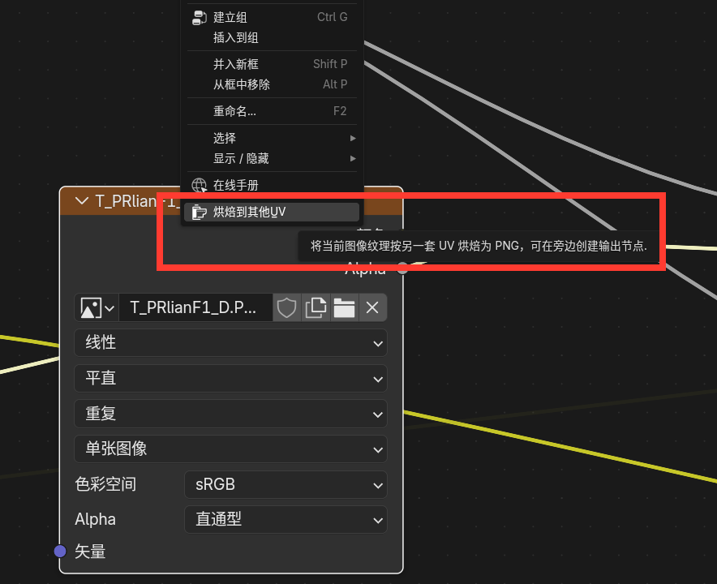

# Blender 烘焙到其他 UV

把已有贴图从一套 UV 转换到另一套 UV，在图像纹理节点上右击即可使用。

适用 **Blender 5.2 LTS**，维护者：**RedialC**。

## 安装

1. [下载插件安装包](https://github.com/JDui/Blender-Bake2OtherUV/raw/refs/heads/main/dist/bake_to_other_uv-1.0.2.zip)，无需解压。
2. 在 Blender 中打开 **编辑 → 偏好设置 → 插件 → 右上角菜单 → 从磁盘安装**。
3. 选择下载的 ZIP，启用 **Bake to Other UV**。

## 使用

1. 选中拥有 UV 的网格物体，切换到 **物体模式**。
2. 在 **着色编辑器** 中右击已指定图像的 **图像纹理节点**，选择 **烘焙到其他UV**。
3. 选择 **输入 UV** 和 **输出 UV**：输入默认识别节点使用的 UV；输出默认使用模型的渲染 UV（UV 列表中的相机图标）。
4. 设置输出名称、分辨率和输出方式，点击 **开始烘焙**。

输出名称可以修改，默认为 `当前贴图名_输出UV名.PNG`。切换输出 UV 时自动更新名称；手动改名后保留输入。同名文件自动编号，避免覆盖。

- **导出 PNG**：将贴图保存到选择的目录。
- **导入回 Blender**：先保存 `.blend` 工程。插件会在工程旁寻找或创建 `TEX` 目录，将贴图保存在里面，并在原节点旁生成新的图像纹理节点，自动连接所选输出 UV。

## 注意

- 只烘焙当前物体中使用此材质的面，保留原材质连接。
- 默认保留透明通道和可识别的 Mapping 等坐标处理。
- 目前支持单张图像，输出为 **8 位 RGBA PNG**，暂不支持 UDIM、图像序列或影片。
- 目标 UV 应放在 0–1 范围内，避免重叠；法线贴图只转换图像通道，不重新计算切线空间方向。
- 烘焙期间请稍候，完成后保存工程以保留新节点。

许可证：[GPL-3.0-or-later](LICENSE)。
